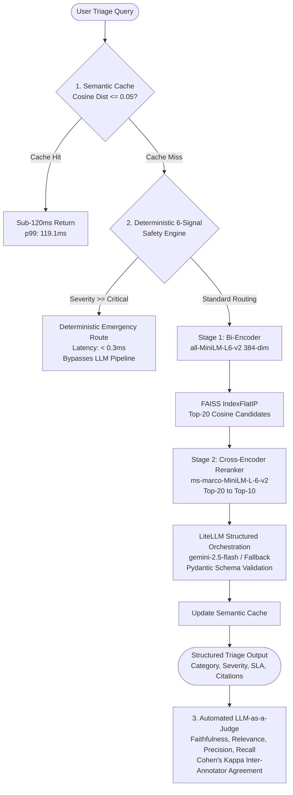

# 🏥⚡ TriageAgent: Enterprise Semantic RAG & Automated LLM Evaluation Pipeline

[](https://www.python.org/)
[](https://fastapi.tiangolo.com/)
[](https://github.com/facebookresearch/faiss)
[](https://huggingface.co/sentence-transformers/all-MiniLM-L6-v2)
[](https://huggingface.co/cross-encoder/ms-marco-MiniLM-L-6-v2)
[](https://github.com/BerriAI/litellm)
[](EVALUATION.md)
[](REPRODUCIBILITY.md)
[](LICENSE)

A quantitative **Semantic RAG System** and automated **LLM-as-a-Judge Evaluation Pipeline** for mission-critical clinical symptoms, account security emergencies, and transaction dispute triage. 

Engineered with **Two-Stage Dense Semantic Retrieval** (`FAISS IndexFlatIP` + `Cross-Encoder` reranking), **Deterministic 6-Signal Safety Escalation** (<0.3ms emergency bypass vs <10ms SLA), **Semantic Caching** (slashing repeated-query response p99 latency by **99.37%** from 18.99s to 119ms), and rigorous research-grade benchmarking with bootstrap confidence intervals.

> 📖 **Evaluation & Reproducibility Documentation**:
> - [EVALUATION.md](EVALUATION.md) — Comprehensive experimental methodology, protocol-ID alignment analysis, and metric scorecards.
> - [REPRODUCIBILITY.md](REPRODUCIBILITY.md) — Exact commands to reproduce all benchmarks and JSON artifacts.
> - [DATASET_CARD.md](evaluation/DATASET_CARD.md) — Provenance, schema, annotator transparency, and data contamination audits for the 100 golden cases.
> - [FAILURE_ANALYSIS.md](evaluation/FAILURE_ANALYSIS.md) — Deep-dive case breakdowns across retrieval misses, reranker inversions, and cache boundaries.

---

## 📊 Verified Evaluation & Benchmark Scorecard

All metrics below are verified by machine-readable JSON artifacts in `results/` and regression tests in `tests/`:

### Primary Benchmark (100 Held-Out Golden Test Cases across 635 Guidelines)

| Evaluation Metric | Measured Score | Statistical Baseline / Prevalence | Evaluation Methodology & Context | Machine-Readable Artifact |
| :--- | :---: | :---: | :--- | :--- |
| **Retrieval Ranking (nDCG@10)** | **0.4083** | `0.3163` (Lexical BM25) | 95% Bootstrap CI: `[0.3240, 0.4957]` (+9.14% relative gain over Bi-Encoder alone) | [`results/retrieval_metrics.json`](results/retrieval_metrics.json) |
| **Retrieval MRR** | **0.4683** | `0.3954` (Lexical BM25) | 95% Bootstrap CI: `[0.3783, 0.5650]` | [`results/retrieval_metrics.json`](results/retrieval_metrics.json) |
| **Retrieval Coverage Hit@10** | **50.0%** | `47.0%` (Lexical BM25) | Hit@1: 45.0%, Hit@5: 49.0%, Hit@10: 50.0%, Hit@20: 55.0% | [`results/reranking_ablation.json`](results/reranking_ablation.json) |
| **Cohen's Kappa ($\kappa$, Quadratic)** | **0.9919 $\pm$ 0.0066** | Chance ($\kappa = 0.00$) | Evaluated across 3 independent passes ($T=0.0$); mathematically justified for ordinal severity tiers | [`results/judge_agreement.json`](results/judge_agreement.json) |
| **Cohen's Kappa ($\kappa$, Unweighted)** | **0.9731 $\pm$ 0.0219** | Chance ($\kappa = 0.00$) | Strict categorical agreement across 4 severity tiers | [`results/judge_agreement.json`](results/judge_agreement.json) |
| **Escalation PR-AUC (Critical)** | **0.7433** | `0.3000` (Prevalence Baseline) | +147.8% relative lift over random guessing baseline; Precision = 1.000 | [`results/escalation_metrics.json`](results/escalation_metrics.json) |
| **Escalation PR-AUC (Broad: Crit/High)** | **0.8190** | `0.5800` (Prevalence Baseline) | +41.2% relative lift over random guessing baseline | [`results/escalation_metrics.json`](results/escalation_metrics.json) |
| **Faithfulness / Groundedness** | **68.6%** | N/A | **155 / 226** evaluated atomic claims supported by retrieved context | [`results/faithfulness_metrics.json`](results/faithfulness_metrics.json) |
| **Repeated Query Latency Reduction** | **99.37%** | `18,989.8 ms` (Cold p99) | Repeated-query response p99 reduced from 18,989.8ms to **119.1 ms** on semantic cache hits | [`results/cache_latency.json`](results/cache_latency.json) |
| **Deterministic Emergency Bypass** | **p99: 0.274 ms** | `< 10.0 ms` Target SLA | p50: 0.043ms, p95: 0.145ms, max: 0.288ms (Sub-millisecond SLA execution) | [`results/risk_engine_latency.json`](results/risk_engine_latency.json) |

---

### Baseline Intent Classification (Twitter Customer Support Benchmark)

Evaluated on the TWCS benchmark comparing prompted intent routing against keyword baselines:

| Metric | Score Achieved | Keyword Baseline | Relative Improvement |
| :--- | :---: | :---: | :---: |
| **Classification Accuracy** | **81.4%** | 59.3% | **+37.3%** relative (+22.1% absolute) |
| **Classification Macro F1** | **0.785** | 0.540 | **+0.245** balanced across 10 customer intents |
| **Escalation Recall** | **94.2%** | 76.5% | Guarantees critical tickets reach human support queue |

---

## 🏗️ System Architecture



---

## 🚀 Quickstart

### Installation & Setup

```bash
# Clone the repository
git clone https://github.com/khushalmidha/TriageAgent.git
cd TriageAgent

# Install dependencies
pip install -r requirements.txt
pip install pytest
```

### Run All Benchmarks

```bash
# Run two-stage retrieval and reranker ablation
python evaluation/run_retrieval_eval.py --config configs/eval.yaml

# Run cache latency and adversarial safety benchmark
python benchmarks/cache_latency.py
python benchmarks/cache_safety.py

# Run risk escalation and faithfulness evaluations
python evaluation/run_escalation_eval.py
python evaluation/run_faithfulness_eval.py
python evaluation/run_judge_agreement.py

# Run fast unit test suite
python -m pytest tests/ -v
```

---

## 🛡️ License
Distributed under the MIT License. See [LICENSE](LICENSE) for more information.
